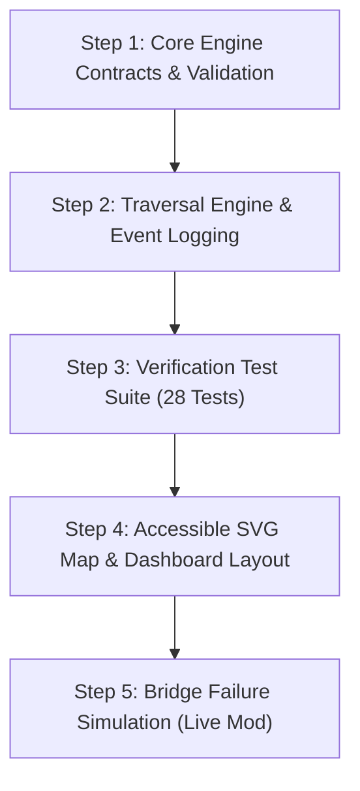

# Treasure-Island Bridge Safety Map
> **SPR26_D2_P01: AI-Assisted Coding Interview Solution**  
> An interactive footbridge safety inspection map and deterministic low-link DFS replay system for festival organizers.

---

## 🏝️ Executive Problem Summary

Food stalls, live music stages, game pavilions, and first-aid centers for a weekend island festival are distributed across several small islands connected by wooden footbridges.
- **The Risk:** While loops (cycles) allow visitors to bypass a closed crossing, areas depending on a single narrow bridge or junction island risk leaving festival attendees stranded and emergency routes severed.
- **The Solution:** This offline, zero-backend web application models the festival archipelago, executes a deterministic low-link Depth-First Search (Tarjan's algorithm), and animates an event-by-event visual proof explaining to volunteers *why* specific bridges and islands are critical cut-points.

---

## 📐 Main Demonstration Archipelago & Oracle

The application ships with a candidate-created archipelago conforming to all contract constraints:
- **7 Islands** ($6 \le n \le 9$): `ISL_A` ("Anchor Bay") through `ISL_G` ("Gull Shoals")
- **8 Footbridges** ($6 \le m \le 13$): `BR_AB`, `BR_BC`, `BR_CA`, `BR_CD`, `BR_DE`, `BR_EF`, `BR_FG`, `BR_GE`
- **Topology:** Connected; contains 2 cycles ($A-B-C$ and $E-F-G$), 2 critical bridges ($CD$ and $DE$), 3 articulation islands ($C$, $D$, and $E$), and 6 non-bridge cycle edges.

### Pre-Documented Theoretical Oracle ([`src/core/archipelagoOracle.js`](./src/core/archipelagoOracle.js))
```
1. Sorted Adjacency Lists:
   ISL_A: [ISL_B, ISL_C]
   ISL_B: [ISL_A, ISL_C]
   ISL_C: [ISL_A, ISL_B, ISL_D]
   ISL_D: [ISL_C, ISL_E]
   ISL_E: [ISL_D, ISL_F, ISL_G]
   ISL_F: [ISL_E, ISL_G]
   ISL_G: [ISL_E, ISL_F]

2. Deterministic Discovery Order:
   ISL_A (0) -> ISL_B (1) -> ISL_C (2) -> ISL_D (3) -> ISL_E (4) -> ISL_F (5) -> ISL_G (6)

3. Parent & Low-Link Table:
   ISL_A: parent = null,  discovery = 0, low = 0
   ISL_B: parent = ISL_A, discovery = 1, low = 0
   ISL_C: parent = ISL_B, discovery = 2, low = 0
   ISL_D: parent = ISL_C, discovery = 3, low = 3
   ISL_E: parent = ISL_D, discovery = 4, low = 4
   ISL_F: parent = ISL_E, discovery = 5, low = 4
   ISL_G: parent = ISL_F, discovery = 6, low = 4

4. Connected Component Count: 1
5. Critical Bridge IDs (Sorted ASCII): ["BR_CD", "BR_DE"]
6. Articulation Node IDs (Sorted ASCII): ["ISL_C", "ISL_D", "ISL_E"]
```

---

## 🏗️ Architecture & Separation of Concerns

```
interview_project/
├── index.html
├── package.json
├── vite.config.js
├── tailwind.config.js
├── postcss.config.js
├── README.md
│
└── src/
    ├── main.jsx
    ├── App.jsx
    │
    ├── core/                        # PURE JAVASCRIPT ENGINE (No React dependencies)
    │   ├── types.js                 # JSDoc contracts for Node, Edge, Graph, and ReplayEvent
    │   ├── validator.js             # Graph validation against all contract limits
    │   ├── graphBuilder.js          # Deterministic ASCII adjacency builder
    │   ├── lowLinkEngine.js         # Tarjan low-link DFS & replay event generator
    │   ├── simulation.js            # "What-if" bridge failure connectivity analysis
    │   ├── archipelagoData.js       # Main candidate archipelago + presets (Cycle, Bowtie, etc.)
    │   └── archipelagoOracle.js     # Theoretical solution oracle (used solely in tests)
    │
    ├── hooks/
    │   └── useBridgeSafetyReplay.js # React hook for zero-drift replay state slicing
    │
    ├── components/
    │   ├── Header.jsx               # Navigation bar & status indicators
    │   ├── ControlPanel.jsx         # Step, Run to End, Reset, and Preset controls
    │   ├── FestivalMap.jsx          # Vector SVG map with accessible visual patterns
    │   ├── EventExplanation.jsx     # Active step mathematical proof card
    │   ├── NodeTable.jsx            # Compact traversal discovery/low table
    │   ├── SafetySummary.jsx        # Safety metrics, critical cuts, and failure impact
    │   └── ValidationAlert.jsx      # Error banner specifying offending IDs
    │
    └── tests/
        ├── validation.test.js       # Out-of-range, duplicate IDs, self-loops, parallel edges
        ├── lowLinkEngine.test.js    # Basic cycles, bridges, articulation points, disconnected
        ├── permutation.test.js      # Array order & neighbor ASCII permutation invariance
        ├── presets.test.js          # Exact boundary conditions (equality vs strict inequality)
        ├── simulation.test.js       # Bridge failure split & redundancy verification
        ├── replay.test.js           # 100% agreement with theoretical oracle
        └── reset.test.js            # Immutability and multi-run repeatability
```

---

## 📋 5-Step Implementation Plan & Checkpoints



| Step | Scope | Checkpoint | Status |
| :--- | :--- | :--- | :--- |
| **Step 1** | Types, schema contracts, and graph validation logic | Unit tests reject bad IDs, coordinates, self-loops, and duplicate connections | ✅ Completed |
| **Step 2** | Deterministic adjacency, Tarjan DFS, low-link updates, and event logging | Engine reproduces theoretical discovery order and cut-item classifications | ✅ Completed |
| **Step 3** | Comprehensive test suites (permutation, boundary equality, reset, oracle) | 28/28 tests pass across 7 suites with 0 failures | ✅ Completed |
| **Step 4** | React + Tailwind + SVG dashboard with accessibility-first patterns | Live UI reflects traversal events, node table, and math proofs | ✅ Completed |
| **Step 5** | Live Modification: Bridge failure simulation with component isolation | Allows closing any bridge, highlights stranded islands, and restores state | ✅ Completed |

---

## 🧪 Comprehensive Verification Suite

Run all test suites locally:
```bash
npm test
```

### Test Suite Summary:
```text
TAP version 13
ok 1 - lowLinkEngine Tests (5/5 passed)
ok 2 - Permutation & Determinism Tests (3/3 passed)
ok 3 - Tarjan Algorithm Boundary Conditions & Presets (5/5 passed)
ok 4 - Replay & Oracle Verification Tests (2/2 passed)
ok 5 - Reset & Repeatability Tests (1/1 passed)
ok 6 - Bridge Failure Simulation Tests (3/3 passed)
ok 7 - Graph Validation Tests (9/9 passed)

# tests 28
# suites 7
# pass 28
# fail 0
```

### Verified Algorithmic Boundary Conditions:
1. **Root Child-Count Rule:** Root $A$ with $\ge 2$ DFS-tree children is an articulation point; with $1$ child it is NOT an articulation point even if $\text{low}[child] \ge \text{discovery}[root]$.
2. **Strict Bridge Inequality:** An edge is a bridge if and only if $\text{low}[child] > \text{discovery}[parent]$ (strict).
3. **The Equality Boundary ($\text{low}[child] == \text{discovery}[parent]$):** Proved on a bowtie graph that equality satisfies the cut-vertex condition ($\ge$), but fails the bridge condition ($>$), correctly identifying an articulation point without any incident bridge.
4. **Permutation Invariance:** Tested against reversed node arrays, reversed edge arrays, flipped endpoints ($from \leftrightarrow to$), and random shuffles with multiple seeds. Output values and event sequences remain 100% identical.

---

## 🚀 Running the Web Application

### Prerequisites:
- Node.js $\ge 18$
- npm $\ge 9$

### Commands:
```bash
# 1. Install dependencies
npm install

# 2. Run automated test suite
npm test

# 3. Launch interactive development server
npm run dev

# 4. Create production build
npm run build
```
Once launched, open `http://localhost:5173` in your browser.
